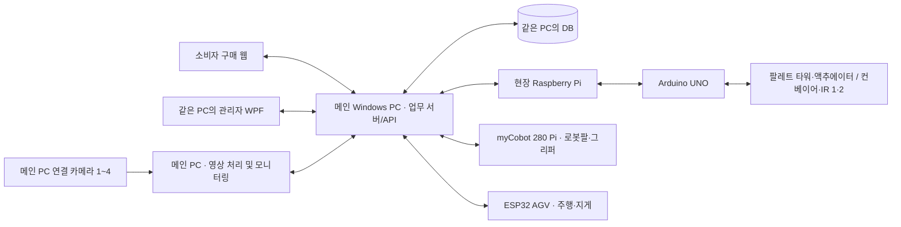

# 주문형 로봇 조립 라인 · 하드웨어 구성과 작동 순서

2026-11-20 팀 합의 기준. 소비자가 주문한 머리·왼팔·오른팔을 팔레트 위 본체에 조립하고, AGV가 완성품을 암실에서 검사받은 뒤 판정에 따라 배송지 또는 오류 구역으로 운반한다. 이 문서는 **통합 시 구현하고 검증할 동작 기준**이다. 현재 펌웨어·데모와의 차이는 마지막 절에 적었다.

## 1. 전체 제어 구성

| 구성 | 장치와 역할 |
|---|---|
| 메인 Windows PC | 업무 서버·API·DB·관리자 WPF를 실행한다. 카메라 4대를 연결하고 위치 인식·좌표 보정·YOLO 검사와 공정 모니터링을 담당한다. 현장 Pi, 로봇 내장 Pi, ESP32와 명령·상태를 교환한다. |
| 현장 Raspberry Pi → Arduino UNO | 서버와 UNO 사이에서 이송 명령·상태를 전달한다. UNO가 팔레트 타워의 액추에이터 구동부·리니어 액추에이터, 컨베이어 모터 드라이버·구동 모터를 제어하고 IR 1·2를 읽는다. |
| myCobot 280 Pi | 내장 Pi에서 작업 좌표와 주문 사양을 받아 로봇팔·그리퍼로 부품을 집어 장착한다. |
| ESP32 AGV | 차체의 모터 드라이버와 바퀴 모터 4개를 제어한다. 전방 라인트레이싱 센서 6개, 후방 센서 3개, 지게 모듈 및 GPIO23의 SG90 서보를 사용한다. |
| 암실 | 암실 구조물·LED 링조명·카메라 3으로 촬영 조건을 유지한다. AGV에 팔레트를 실은 채 검사한다. |
| 전원부 | 각 장비의 전원 공급장치와 AGV 배터리로 구성한다. |

### 카메라 배치

| 번호 | 용도 | 촬영 시점과 결과 |
|---|---|---|
| 1 | 투입 QR 정보 등록 | 팔레트가 배출된 직후 QR을 읽는다. 메인 PC가 팔레트·이번 회차·수락 주문의 사양을 DB에 연결한다. |
| 2 | 로봇팔 좌표 보정 | 조립 위치 정차 후 작업 위치를 촬영한다. 메인 PC가 작업 좌표를 인식·보정해 로봇팔에 전달한다. |
| 3 | 암실 QR 대조·YOLO 완성품 검사 | AGV의 검사 정차선 도착 완료 신호로 촬영한다. 같은 영상에서 팔레트 QR을 읽고 머리·양팔의 종류와 누락 여부를 판정한다. |
| 4 | 전체 공정 모니터링 | 1~12단계와 병행하여 메인 PC에서 현장 전체를 관찰한다. |

## 2. 팔레트 한 장의 작동 순서

| 단계 | 동작 | 다음 단계로 넘어가는 조건 |
|---|---|---|
| 1. 구매 및 제작 승인 | 소비자가 구매 웹에서 로봇 사양과 배송지를 선택한다. 서버가 주문을 DB에 저장해 WPF에 표시한다. 관리자가 제작을 수락하면 수락 이력을 저장한다. | 작업 중에도 수락할 수 있다. 라인에는 팔레트 한 장씩 투입하며 대기 주문은 WPF 수락 순서로 처리한다. |
| 2. 팔레트 배출 | 메인 PC → 현장 Pi → UNO → 액추에이터 구동부 → 리니어 액추에이터 순으로 지시해 타워에서 QR 팔레트 한 장을 배출한다. | 배출된 팔레트를 판독할 동안 벨트는 정차한다. |
| 3. QR 등록 및 벨트 출발 | 카메라 1이 QR을 읽는다. 메인 PC가 QR과 주문 사양의 배정을 DB에 저장한 후 현장 Pi를 통해 UNO에 출발을 지시한다. UNO가 드라이버를 통해 컨베이어 모터를 구동한다. | QR 판독과 같은 회차의 DB 저장이 모두 성공해야 출발한다. |
| 4. 조립 위치 정차 | IR 1이 팔레트를 감지하면 UNO가 컨베이어 모터를 멈춘다. 현장 Pi를 통해 메인 PC에 정차 상태를 전달한다. | 메인 PC가 해당 팔레트의 조립 위치 정차를 확인한다. |
| 5. 로봇 조립 | 카메라 2로 작업 위치를 촬영한다. 메인 PC가 좌표를 보정해 주문 사양과 함께 myCobot 280 Pi로 보낸다. 로봇팔·그리퍼가 지정 부품을 집어 조립한다. | 마지막 부품 장착 후 **로봇팔이 대기 자세에 도착**하면 해당 회차의 조립 완료를 메인 PC에 알린다. |
| 6. 컨베이어 재가동 | 조립 완료를 받은 메인 PC가 현장 Pi → UNO를 통해 이송 재개를 지시한다. UNO가 드라이버·모터를 구동해 조립품을 이송한다. | 팔레트가 컨베이어 끝을 향해 이동한다. |
| 7. 컨베이어 끝 정차 | IR 2가 팔레트를 감지하면 UNO가 벨트를 멈춘다. 팔레트는 컨베이어 끝 **1번 인수 위치**에 정차한다. | 메인 PC가 정차 보고를 받고 AGV를 호출한다. 인수 중에도 벨트는 정지한다. |
| 8. AGV 인수 | **2번·지게 85°**로 대기하던 AGV가 전방 센서 6개로 라인을 따라 1번까지 전진해 정차한다. 포크를 팔레트 아래에 둔 상태에서 GPIO23의 SG90을 **110°**로 올린다. | 지게 상승 동작 완료를 인수 완료로 처리한다. |
| 9. 후진 및 암실 이동 | 지게 **110°**를 유지한 채 후방 센서 3개로 2번까지 후진한다. **후진 진행 방향 기준** 왼쪽 GPIO35, 가운데 GPIO34, 오른쪽 GPIO36이다. 2번에서 전진으로 전환해 배송 경로상의 암실 검사 정차선에 멈춘다. | AGV가 메인 PC에 해당 작업의 검사 정차선 도착 완료를 알린다. 적재 중 2번 경유는 운반 과정이다. |
| 10. 암실 검사 | 서버가 도착 신호를 받으면 LED 링조명 아래 카메라 3으로 촬영한다. 메인 PC가 QR로 등록 사양을 확인하고 YOLO 검출 결과와 대조한다. | 검사 결과를 DB에 기록하고 아래 분기표로 목적지를 결정한다. 판정 불가 시 WPF에 즉시 검사 오류를 표시한다. |
| 11. 목적지 이동 | 메인 PC가 ESP32에 결정된 목적지를 지시한다. AGV가 전방 센서 6개로 라인을 따라 바퀴 모터 4개를 구동해 목적지로 전진하고 정차한다. | 정상은 소비자 지정 HUB, 오류는 유형에 따라 6번 또는 7번이다. |
| 12. 하역·복귀 | 목적지에서 SG90을 **60°**로 내려 하역한다. 후방 센서 3개로 2번까지 후진 복귀해 정차하고 지게를 **85°**로 되돌린다. AGV가 최종 복귀를 보고하고 서버가 DB·WPF에 반영한다. | **하역 후 2번 정차와 지게 85° 복귀가 완료**되어야 이번 이송 사이클을 종료한다. 오류 주문은 재검·재조립 대상으로 유지하고 다음 대기 주문을 투입한다. |

## 3. 정차 위치와 목적지 결정

| 위치 | 현장 용도 | 이동 기준 |
|---|---|---|
| 1번 | 컨베이어 끝·팔레트 인수 | IR 2 정차 보고 후 호출. 2번에서 전진해 지게를 110°로 올린다. |
| 2번 | AGV 대기·경유·복귀 | 최초 대기와 최종 복귀는 85°. 적재 후 후진 경유할 때는 110°를 유지한다. |
| 암실 검사 정차선 | 완성품 검사 | 적재 상태로 2번을 경유해 전진 중 정차한다. 해당 작업의 도착 완료 신호가 촬영을 시작시킨다. |
| 3번 / 4번 / 5번 | 서울 HUB / 평택 HUB / 수원 HUB | QR과 완성품 사양이 모두 주문과 일치하면 소비자가 지정한 HUB로 간다. |
| **6번 · 오류1** | **부품 누락 구역** | 필수 부품이 하나라도 누락된 것으로 확인되면 이곳으로 보낸다. QR 오류가 동시에 발생해도 누락이 우선이다. |
| **7번 · 오류2** | **정보 불일치 오류 구역** | 누락이 확인되지 않은 나머지 오류를 보낸다. 오부품, 검사 시 QR 불일치·미인식, 영상 가림으로 인한 판정 불가를 포함한다. |

두 오류 구역 모두 AGV는 관리자 확인을 기다리지 않고 이송한다. 제어기는 실제 검사 사유와 하역 목적지를 구분해 기록한다. 예를 들어 영상 가림은 WPF에 검사 오류로 표시하고, AGV 목적지는 7번으로 지정한다.

## 4. 통합 시 유지할 공통규약

- **투입 QR 실패**. 최초 판독이 실패하면 2초 간격으로 최대 두 번 더 읽는다. 총 3회 실패 시 벨트를 멈춘 채 WPF에 경고한다. 관리자가 QR을 확인하고 ‘재시도’를 누르면 같은 팔레트를 다시 읽는다. QR은 읽었으나 DB 저장이 실패한 경우에는 QR·주문·회차를 유지하고 ‘저장 재시도’로 배정 저장만 다시 시도한다.
- **주문·권한**. 소비자는 관리자 수락 전까지 본인 주문을 취소할 수 있다. 1차 관리자와 최상위 관리자 모두 WPF에서 주문 수락, 팔레트 배출 전 생산 대기 주문 취소, 설비 정지·재시작을 할 수 있다. 관리자 계정 생성·등급 변경은 최상위 관리자 권한이다.
- **복구**. 서버는 주문·팔레트·공정 단계와 명령 처리 상태를 저장한다. 통신·전원 복구 시 장비의 실제 상태를 대조하고 중단 지점에서 이어간다. 배출·파지·하역이 이미 완료된 경우 같은 동작의 중복 실행을 막는다.

## 5. 구현 자료와 대조한 결과

| 비교 대상 | 확인된 차이와 통합 시 확인할 동작 |
|---|---|
| UNO 이송 진행본 | 진행본은 액추에이터 복귀와 벨트 출발을 함께 시작하고, IR 1 감지 후 추가 이송·3초 조립 대기·재출발, IR 2 감지 후 추가 이송을 수행한다. 통합 기준은 **QR·DB 배정 성공 후 최초 출발**, **대기 자세 도착 후 재출발**이다. IR 1·2로 각 정차 위치를 확보하는지 실물에서 확인한다. [UNO 진행본 #11](https://github.com/Esp3ra/2026-Moble-3rd-Team-Project/pull/11) |
| ESP32 AGV 진행본 | 1~7번 위치, 지게 각도, 후방 핀 방향과 서버 주도의 이동 흐름을 대조했다. 진행본의 기본 배송 예시는 적재 후 2번에서 목적지로 전진한다. 통합 공정에는 **암실 정차·도착 보고 → 검사 결과 저장 → 목적지 지시**가 들어간다. 진행본에서 서버는 HTTP 상태 조회로 도착을 확인하므로 검사 정차선과 해당 회차의 완료 상태 연결을 검증해야 한다. [AGV 진행본 #12](https://github.com/Esp3ra/2026-Moble-3rd-Team-Project/pull/12) |
| 웹·서버·WPF 배송 데모 | 데모의 3~7번 명칭과 대조했다. 통합 시 주문에서 소비자가 선택한 HUB와 실제 판정에 따른 오류 목적지를 사용한다. [통합 데모 #13](https://github.com/Esp3ra/2026-Moble-3rd-Team-Project/pull/13) |

문서 검증과 별도로 남은 실물 통합 시험은 정상 HUB 배송, 6·7번 각각의 오류 배송, 암실 촬영과 AGV 정차 신호의 연계, 최종 2번·85° 복귀까지의 한 사이클이다.
