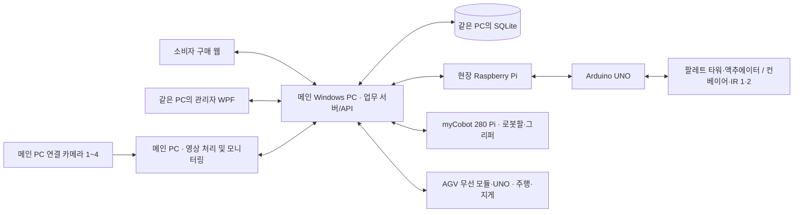

# 주문형 로봇 조립 라인 · 하드웨어 구성과 작동 순서

2026-11-26 서버·DB·WPF 팀 회의 반영. 메인 Windows PC의 업무 서버 하나가 컨베이어·로봇팔·AGV의 상태를 관리하고 다음 장비를 지시한다. [팀 규약](프로젝트_전체규약_팀답변_공유본.md)과 [공통 통신 규약 v0.3.0](통신규약/공통_통신규약과_DTO.md)을 함께 적용한다.

## 1. 전체 제어 구성

| 구성 | 장치와 역할 |
|---|---|
| 메인 Windows PC | Start-MOBOT 한 번으로 서버와 설정된 장비 연결을 준비하는 것이 목표다. WPF에서 장비별 온라인·준비 상태를 확인한 뒤 관리자가 운전을 시작한다. |
| 현장 Raspberry Pi → Arduino UNO | 메인 PC와 무선으로 연결하고 UNO와는 USB 시리얼을 사용해 이송 명령·상태를 전달한다. UNO가 팔레트 타워의 액추에이터 구동부·리니어 액추에이터, 컨베이어 모터 드라이버·구동 모터를 제어하고 IR 1·2를 읽는다. |
| myCobot 280 Pi | 메인 PC와 무선으로 연결된 내장 Pi에서 작업 좌표와 주문 사양을 받아 로봇팔·그리퍼로 부품을 집어 장착한다. |
| AGV | 현장 목표는 무선 모듈을 장착한 AGV의 UNO와 메인 PC를 연결하는 것이다. Alpha의 ESP32 구현과 현장 모듈 사이의 명령·완료 대응 방식은 미정이다. 전방 센서 6개·후방 센서 3개와 지게를 사용한다. |

| 전원부 | 각 장비의 전원 공급장치와 AGV 배터리로 구성한다. |

### 현장 LAN 장비 주소

| 장비 | IPv4 주소 |
|---|---|
| 메인 PC (서버) | `192.168.1.51` |
| 사용자 노트북 | `192.168.1.52` |
| 로봇팔 | `192.168.1.53` |
| 중계 Pi | `192.168.1.54` |

### 카메라 배치

| 번호 | 용도 | 촬영 시점과 결과 |
|---|---|---|
| 1 | CAM1 QR 등록 | IR1 감지 후 설정 시간만큼 더 이송하고 정차한 뒤 판독한다. 서버가 같은 회차의 팔레트·수락 주문 배정을 저장한다. |
| 2 | 로봇팔 좌표 보정 | 조립 위치 정차 후 작업 위치를 촬영한다. 메인 PC에서 Python/OpenCV로 몸통 마커를 읽고 고정 공급대의 집기 자세와 몸통의 장착 자세를 연결한다. |
| 검사 카메라(미정) | YOLO 완성품 검사 | 조립 완료·대기 자세 복귀 후 팔레트가 정차한 상태에서 주문 사양과 비교한다. 사용할 카메라와 물리적 촬영 위치는 추후 확정한다. |
| 4 | 전체 공정 모니터링 | 운전 중 메인 PC에서 현장 전체를 관찰한다. |

## 2. 팔레트 한 장의 작동 순서

| 단계 | 동작 | 다음 단계로 넘어가는 조건 |
|---|---|---|
| 1. 구매 및 제작 승인 | 소비자가 구매 웹에서 로봇 사양을 선택하고 배송 주소를 입력한다. 서버가 주소 권역으로 정상 배송 HUB를 배정한다. 서버가 주문을 DB에 저장해 WPF에 표시한다. 관리자가 제작을 수락하면 수락 이력을 저장한다. | 작업 중에도 수락할 수 있다. 라인에는 팔레트 한 장씩 투입하며 대기 주문은 WPF 수락 순서로 처리한다. |
| 2. 팔레트 배출 | 서버가 현장 Pi를 통해 UNO에 한 장 배출을 지시한다. | 같은 회차의 배출 완료 후 벨트를 출발시킨다. |
| 3. IR1 이송·정차 | IR1 감지 후 설정 시간만큼 더 이송하고 벨트를 정지한다. | 해당 이송 명령의 정차 완료를 확인한다. |
| 4. CAM1 QR 배정 | 정차 중 QR을 읽어 실물 팔레트와 주문을 같은 회차로 DB에 배정한다. | 판독 또는 저장 실패 시 정차를 유지한다. |
| 5. 로봇 조립 | IR1 정차와 배정 저장 확인 후 CAM2 보정·주문 사양으로 조립을 지시한다. 부품 사이에는 집게를 촬영 영역에서 비키고 CAM2로 다음 장착점을 갱신한다. | 마지막 장착 완료와 팔의 대기 자세 복귀를 함께 확인한다. |
| 6. YOLO 검사 | 같은 회차의 팔레트를 세워 둔 채 검사한다. | 검사 시도별 판정·결함·근거를 DB에 저장한다. |
| 7. 결함 재작업·재검사 | 같은 팔레트와 회차에서 결함을 재작업하고 다시 검사한다. 판정 불가·저장 실패도 정차 상태로 표시한다. | 새 합격 판정 저장 전에는 벨트를 재출발시키지 않는다. 재작업 횟수 상한과 반복 불합격 처리는 미정이다. |
| 8. 벨트 재출발 | 해당 회차의 유효한 합격 판정이 DB에 저장된 뒤 서버가 이송을 지시한다. | IR2 감지 후 설정 시간만큼 더 이송해 1번에서 정차한다. |
| 9. AGV 인수 | IR2 정차 완료를 확인한 서버가 인수를 지시한다. 2번에서 1번으로 이동해 지게를 85°에서 110°로 올린다. | 명령 접수와 지게 상승 완료를 구분해 기록한다. |
| 10. 목적지 이동 | 인수 완료 후 적재한 AGV가 2번을 경유해 주문에 배정된 HUB로 이동한다. | 같은 회차·배송 명령의 도착 완료를 확인한다. |
| 11. 하역 | AGV가 지정 목적지에서 지게를 60°로 내린다. | 해당 회차·하역 명령의 완료 응답을 서버가 확인한 뒤 WPF에 하역 완료를 표시한다. |
| 12. 대기 복귀 | 하역 후 AGV가 2번에 정차하고 지게를 85°로 되돌린다. | 복귀 완료 확인 후 수락 순서상 다음 팔레트 한 장을 투입한다. |

## 3. 정차 위치와 목적지

1번은 IR2 정차·인수 위치, 2번은 AGV 대기·경유·복귀 위치다. 합격품은 주문 주소로 배정된 3번 서울·4번 대전·5번 천안 HUB로 배송한다. 기존 6·7번 오류 구역과 AGV 암실 정차는 개정 공정에서 불합격품의 자동 이송 경로로 사용하지 않는다.

## 4. 통합 시 유지할 공통규약

- **투입 QR 실패**. 최초 판독이 실패하면 2초 간격으로 최대 두 번 더 읽는다. 총 3회 실패 시 벨트를 멈춘 채 WPF에 경고한다. 관리자가 QR을 확인하고 ‘재시도’를 누르면 같은 팔레트를 다시 읽는다. QR은 읽었으나 DB 저장이 실패한 경우에는 QR·주문·회차를 유지하고 ‘저장 재시도’로 배정 저장만 다시 시도한다.
- **주문·권한**. 소비자는 관리자 수락 전까지 본인 주문을 취소할 수 있다. 1차 관리자와 최상위 관리자 모두 WPF에서 주문 수락, 팔레트 배출 전 생산 대기 주문 취소, 설비 정지·재시작을 할 수 있다. 관리자 계정 생성·등급 변경은 최상위 관리자 권한이다.
- **복구**. 서버는 주문·팔레트·공정 단계와 명령 처리 상태를 저장한다. 통신·전원 복구 시 장비의 실제 상태를 대조하고 중단 지점에서 이어간다. 배출·파지·하역이 이미 완료된 경우 같은 동작의 중복 실행을 막는다.

## 5. 정식 WPF 표시

| 상단 단계 | 표시 시점과 상세 정보 |
|---|---|
| 팔레트 배출 | 배출 명령과 완료 상태 |
| QR 인식 | IR1 이송·정차, CAM1 판독과 주문·팔레트 DB 배정 여부 |
| 조립/검사 | 로봇 조립·대기 자세, YOLO 판정·결함 사유·재작업·재검사 이력. 합격 저장 후 IR2 이송·정차도 여기에 표시한다. |
| AGV 인수 | 인수 명령이 접수되면 표시하고 실제 인수 완료는 별도로 표시한다. |
| AGV 하역 완료 | 서버가 같은 회차·명령의 하역 완료 응답을 확인한 뒤 표시한다. |

기존 관리자 계정 로그인, 컨베이어 시험 모드, CAM1 QR ROI, 시작·정지·정지 해제·QR 재시도를 유지하며 소스와 실행 파일을 함께 갱신한다. 장비 오프라인·현장 확인 대기 등으로 버튼을 비활성화하면 이유를 표시한다.

## 6. 시험 서버 진행 상황과 Alpha PR 기준

로봇팔 조립 개시·완료와 재작업 신호, AGV 인수·하역 개시와 완료 신호는 후속 통합 범위다.

- 회의에서 보고된 시험 서버 검증 범위는 배출, IR1 정차, CAM1 QR 배정, IR2 정차까지다. 현재 시험 설정은 IR1 감지 후 **5.80초**, IR2 감지 후 **1.75초** 추가 이송이다. QR 배정 후 **3초 모의 조립 대기**는 시험용이다. 정식 서버에서는 팔의 조립 완료·대기 복귀와 YOLO 합격 저장으로 교체한다.
- 서버·DB·WPF 구현은 Alpha 대상 PR에 포함한다. 기존 DB 마이그레이션과 검사 이력 보존, 정상 흐름, QR 저장 실패, 검사 불합격·재검사, 중복·지연 완료 응답을 모의 환경에서 검증한다. WPF 빌드, 상단 다섯 단계와 버튼 활성화 조건도 확인한다.
- 로봇팔·AGV·YOLO 실물 연동 또는 정식 Pi–UNO v1 검증이 남은 구현 PR은 Draft로 제출하고 확인 범위와 남은 시험을 명시한다. 검사 카메라·촬영 위치, 재작업 횟수 상한·반복 불합격 처리, AGV 무선 모듈 대응은 [통합 이슈 #25](https://github.com/Esp3ra/2026-Moble-3rd-Team-Project/issues/25)에서 추적한다.
